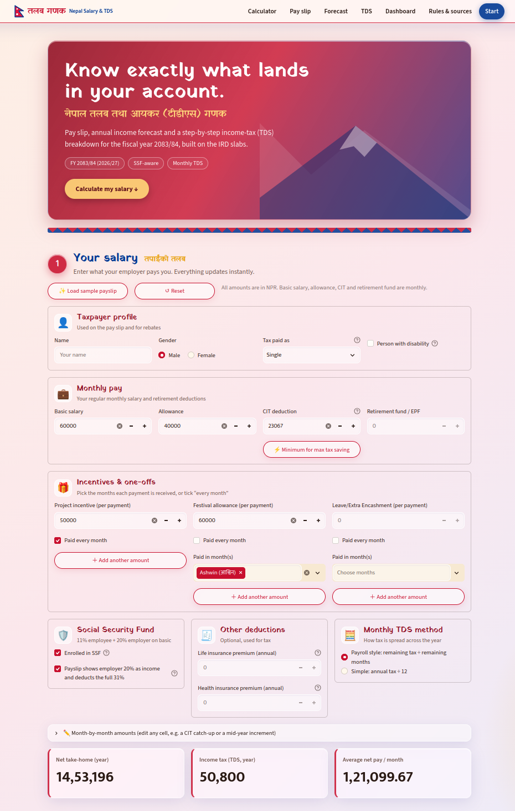
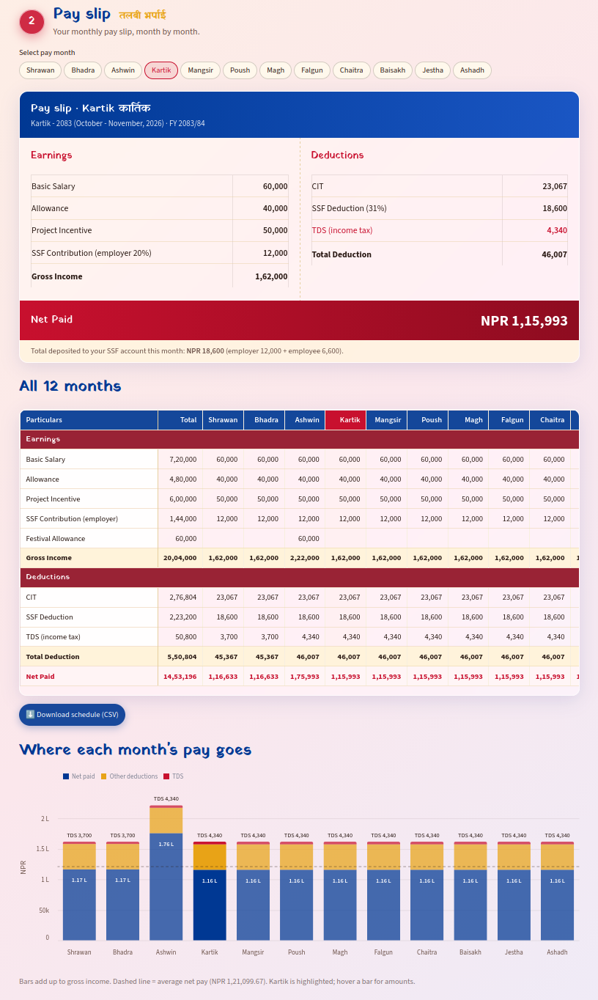
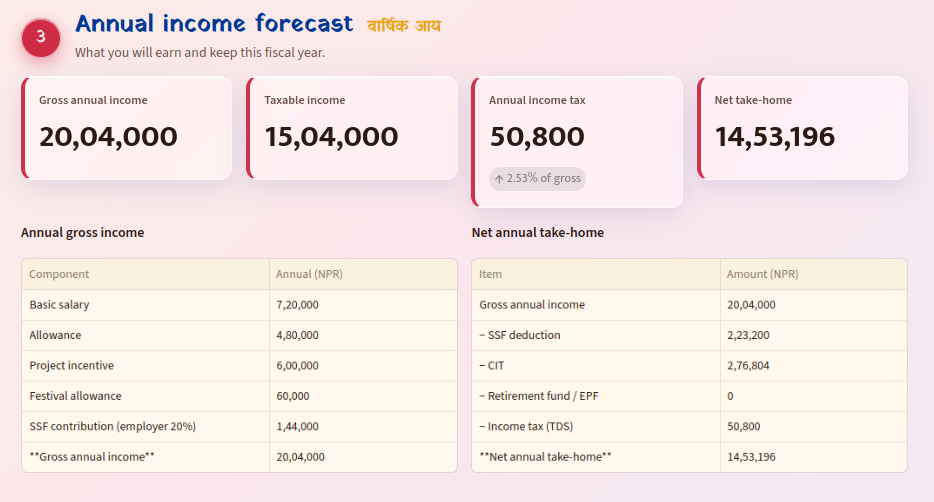
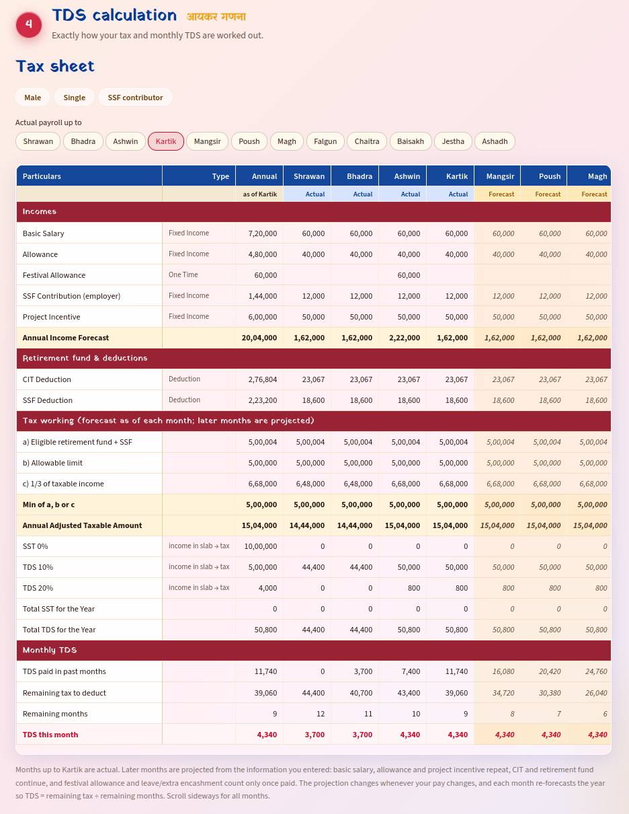
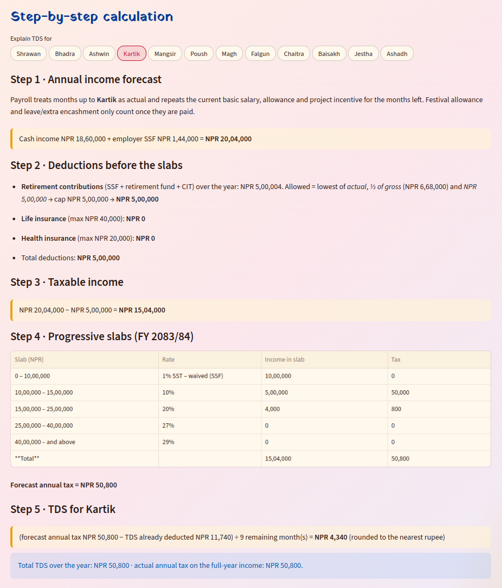
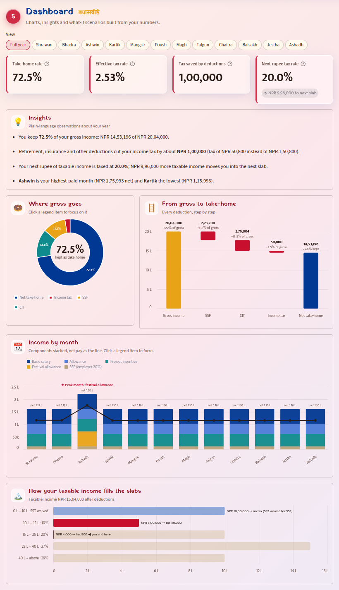
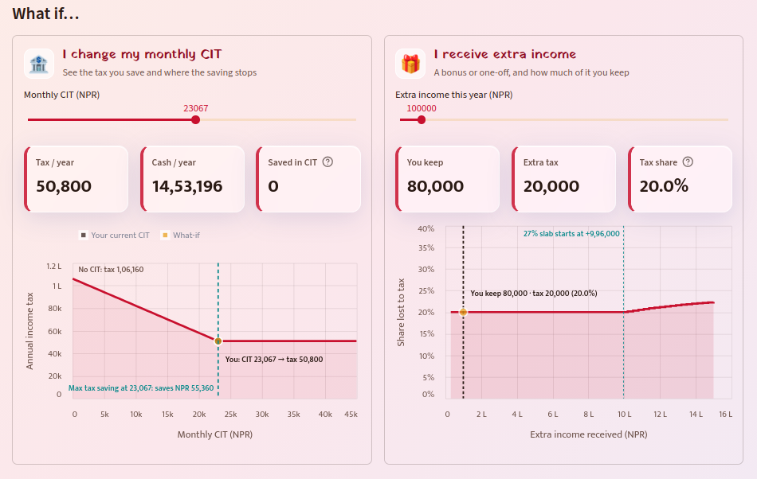
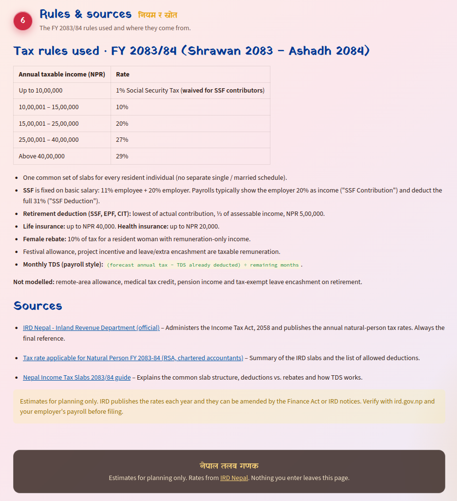

# nepal-salary-calculation

🇳🇵तलब गणक · **Nepal Salary & TDS** — a Streamlit app that turns your monthly salary into a pay slip, an annual
income forecast and a step-by-step income-tax (TDS) breakdown for the fiscal year **2083/84 (2026/27)**,
based on the IRD slabs and SSF-aware.

The app is a single page. The navbar (**Calculator · Pay slip · Forecast · TDS · Dashboard · Rules & sources · Start**)
jumps to each numbered section below; **Start** and the hero's *Calculate my salary* button go to the Calculator.

## Run

> Prerequisite: [uv](https://docs.astral.sh/uv/getting-started/installation/)

1. Create and activate `venv`

```bash
uv venv
source .venv/bin/activate
```

2. Install Dependencies

```bash
uv sync
```

3. Run Streamlit app

```zsh
uv run nepal-salary-calculation   # launches the Streamlit app at : http://localhost:8501
```

4. Test

```bash
uv run pytest   
```

Implements the FY 2083/84 slabs for salaried residents (see the *Rules & sources* section in the app).
Source: [IRD Nepal](https://ird.gov.np/).
Estimates only; verify with IRD and your employer's payroll.


## Sections

> ### 1. Your salary — *Calculator*

Enter what your employer pays you; everything updates instantly. All amounts are in NPR.

- **Load sample payslip / Reset** buttons to fill in example data or start over.
- **Taxpayer profile:** name, gender, tax paid as (single / couple), person with disability.
- **Monthly pay:** basic salary, allowance, CIT deduction and retirement fund / EPF, plus a
  *Minimum for max tax saving* helper for the CIT deduction.
- **Incentives & one-offs:** project incentive, festival allowance and leave/extra encashment, each paid
  every month or only in the months you pick. Use **＋ Add another amount** when a payment differs between
  months (e.g. 20,000 in Mangsir and 35,000 in Magh); amounts in the same month add up.
- **Social Security Fund:** enrolment toggle (11% employee + 20% employer on basic salary) and whether the
  pay slip shows the employer 20% as income and deducts the full 31%.
- **Other deductions:** annual life and health insurance premiums.
- **Monthly TDS method:** payroll style (remaining tax ÷ remaining months) or simple (annual tax ÷ 12).
- **Month-by-month amounts:** editable table for CIT catch-ups, mid-year increments, etc.
- Summary cards: net take-home (year), income tax (TDS, year) and average net pay per month.



> ### 2. Pay slip

Pick any month to see its pay slip: earnings, deductions (CIT, SSF, TDS), total deduction, net paid and
the amount deposited to your SSF account. Below it:

- **All 12 months** table (Shrawan → Ashadh) with totals per line.
- **Download schedule (CSV)** button.
- Stacked chart of net pay, other deductions and TDS for every month, with the average net pay line.



> ### 3. Annual income forecast — *Forecast*

What you will earn and keep this fiscal year: gross annual income, taxable income, annual income tax
(with its share of gross) and net take-home, with an **Annual gross income** breakdown and a
**Net annual take-home** breakdown (SSF, CIT, retirement fund, TDS).



> ### 4. TDS calculation — *TDS*

Exactly how your tax and monthly TDS are worked out.

- **Tax sheet:** choose the month up to which payroll is actual; later months are forecast. Shows incomes,
  retirement fund & deductions, the tax working (eligible contribution, allowable limit, ⅓ of taxable income,
  adjusted taxable amount), slab-wise SST/TDS, and monthly TDS (paid so far, remaining tax, remaining months).



- **Step-by-step calculation:** pick a month for a plain-language walkthrough — annual income forecast,
  deductions before the slabs, taxable income, progressive slabs and the TDS for that month.



> ### 5. Dashboard

Insights and interactive charts built from the numbers you entered (all update instantly):

- **View picker:** *Full year* or any single month (Shrawan … Ashadh). The KPI cards, insights, donut and
  waterfall switch to that month's pay slip, and the month is highlighted in the monthly chart.
- **KPI cards:** take-home rate, effective tax rate, tax saved by deductions and the tax rate on your next
  rupee of income (with the room left before the next slab).
- **Insights:** plain-language observations, e.g. what you keep, how much your deductions save, whether a
  higher CIT would save more tax, and your highest- and lowest-paid months.
- **Where gross goes** (donut, with % of gross) and **From gross to take-home** (waterfall, with amount and
  % of gross on every step). Click a legend item to focus on it, hover for amounts.
- **Income by month:** stacked income components with your net pay as a line, net pay labelled on every
  month and the peak month annotated.
- **Slab chart:** how your taxable income fills each slab, the tax it produces and where you end.
- **What if…:** a *monthly CIT* slider (tax saved, cash take-home, and where saving stops) and an *extra
  income* slider (how much of a bonus you keep, and how the tax share steps up at each slab). Both charts
  annotate your position, the key thresholds and the saving.





> ### 6. Rules & sources — *Rules & sources*

The FY 2083/84 rules used and where they come from:

- Slabs: up to 10,00,000 at 1% SST (waived for SSF contributors), then 10%, 20%, 27% and 29% above
  40,00,000. One common slab table for every resident individual.
- SSF fixed on basic salary (11% employee + 20% employer).
- Retirement deduction (SSF, EPF, CIT): lowest of actual, ⅓ of assessable income, or NPR 5,00,000.
- Life insurance up to NPR 40,000; health insurance up to NPR 20,000.
- 10% female rebate for a resident woman with remuneration-only income.
- Festival allowance, project incentive and leave/extra encashment are taxable remuneration.
- Not modelled: remote-area allowance, medical tax credit, pension income, tax-exempt leave encashment on retirement.


